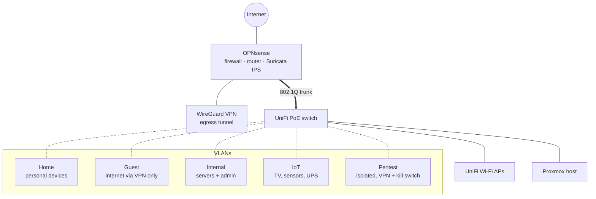
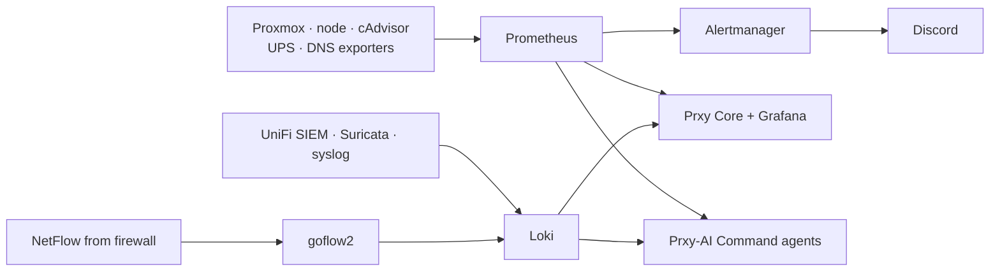

# Secure Homelab

**A segmented, monitored, privacy-first homelab: about 30 services on one Proxmox host, behind an
OPNsense firewall with intrusion prevention.** This repo documents the design. The custom apps that run on it have their own repos.

> Proxmox VE 9 · LXC/KVM · OPNsense · Suricata (IPS) · WireGuard · UniFi · VLANs · Prometheus · Loki ·
> Grafana · Alertmanager · NetFlow (goflow2) · Unbound · NextDNS · Docker · Nginx Proxy Manager · Ollama (RTX 3060)

## Network design

| Segment | Purpose | Policy (summary) |
|---|---|---|
| Home | Phones, laptops | Internet; no access to servers or the firewall admin |
| Guest | Visitors | Internet **only through the VPN**, DNS to the firewall, every private range blocked |
| Internal | Servers, management | Admin access to the lab and firewall comes only from here |
| IoT | TV, smart devices, UPS | Internet + DNS only; can't start connections to other VLANs (one narrow exception per device) |
| Pentest *(in progress)* | Attack VM | Internet through the VPN only, kill switch, all private ranges dropped (see [pentest-lab](https://github.com/proxy9108/pentest-lab)) |

Hardening highlights:
- Default-deny between VLANs; **DNS-over-TLS (853) blocked** so devices can't skip filtered DNS.
- **Suricata in IPS mode** on the firewall; logging enabled on every block rule.
- Firewall rules are **baselined and watched** by [Prxy Core](https://github.com/proxy9108/prxy-core), which flags changes
  and rules that can never match.
- Every integration uses **dedicated read-only API accounts** with pinned TLS. No admin keys sit in apps.
- No inbound port forwards; remote admin goes over a private mesh VPN.

## Compute
One Proxmox VE host (16 threads, 1 TB NVMe, NVIDIA RTX 3060 12 GB passed through to an LXC for local AI).
About 30 unprivileged LXC containers, one per service, plus on-demand VMs.

| Area | Services |
|---|---|
| Custom apps | Prxy Core (control center), Prxy-AI Command (AI ops team), Prxy TV feed + briefing, AutoTrack |
| Monitoring | Prometheus, Alertmanager, Grafana, Loki (UniFi SIEM, Suricata, syslog), goflow2 (NetFlow), Uptime Kuma, Smokeping, Speedtest Tracker, Proxmox + UPS + DNS exporters |
| Data | PostgreSQL, Redis, MongoDB, InfluxDB |
| Productivity | Nextcloud, Wiki.js, n8n, code-server, SearXNG |
| AI | Ollama (GPU), Open WebUI |
| Edge | Docker host with Nginx Proxy Manager, Cloudflare Tunnel, Homepage dashboard, Portainer |
| Home | Home Assistant, Mosquitto MQTT, UPS exporter |
| DNS | Unbound (recursive) + NextDNS (filtering) |

## Observability

## Backups & recovery
- Nightly Proxmox backup job (keep last 3) to a dedicated thin volume. Prxy Core flags any guest without a backup in 26 h.
- Snapshots before every automated change, with automatic rollback (Prxy-AI Command).
- UPS with telemetry: low-battery and stale-data alerts.

## Privacy policy (applied to the whole lab)
**Data that identifies a person or device is kept at most 24 hours. Anonymous totals may stay.**
- Loki retention 24 h; NetFlow and syslog files rotate daily; reverse-proxy access logs rotated every 24 h.
- Home Assistant and Nextcloud activity purged after 1 day.
- Firewall block history keeps raw rows for 24 h, then rolls them up into anonymous counts.
- Self-hosted fonts, no third-party trackers in self-built apps.

## Lessons learned
- Segment first, then monitor. Most of the useful alerts came from traffic *between* VLANs.
- Read-only by default makes integrations safe to build quickly. Write access is the exception and is audited.
- A firewall rule can look correct and never match. Checking rule order automatically catches it.
- Privacy is a design input: deciding the retention period up front shaped every data pipeline.
